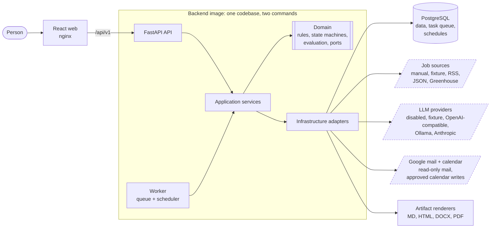

# Architecture diagram

Dashed boxes are optional integrations: the product works with none of them configured (AI off, no mailbox, manual and fixture sources only). The domain depends on nothing outside itself; adapters implement ports defined in `domain/*/ports.py`.

## Request path

`Browser → web → API route (validation, schemas) → application service (profile-scoped use case) → domain rules + infrastructure (SQLAlchemy / adapters) → PostgreSQL`

## Background path

`Scheduler tick (row-locked) → task row → worker lease → handler (search, extract, re-evaluate, prune) → result or recorded failure`
